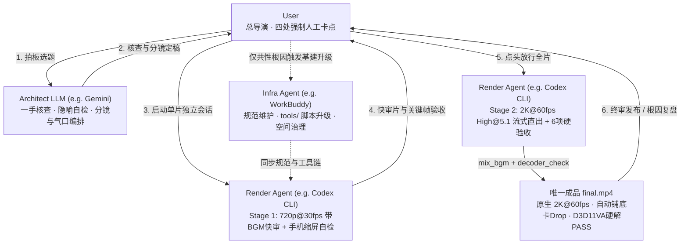

# MakeYourVideo

> **0 人声 · 原生 2K@60fps 的 Vibe 科普短片生产框架**（Remotion + Python + FFmpeg）

**MakeYourVideo** 是一套 0 人声、电影感 9:16 竖屏知识短片的生产框架：单份 `beats.json` 时间轴驱动全片，Remotion 掌管动效与排版，Python 负责卡拍配乐、立体声微音效与硬解验收。程序只强制两处人工签字——`review` 样片确认与 `delivery` 终审采纳；选题与事实在策划对话里拍板。

```bash
git clone https://github.com/Heersley/MakeYourVideo.git
cd MakeYourVideo
```

## 🎬 成片演示 / Showcase

> **完整成片观看（Bilibili）**：👉 **[点击观看成品演示](https://t.bilibili.com/1273093177771819012)**
>

<table>
  <tr>
    <td align="center" width="25%">
      <br/>
      <sub><b></sub>
    </td>
    <td align="center" width="25%">
      <br/>
      <sub><b></sub>
    </td>
    <td align="center" width="25%">
      <br/>
      <sub><b></sub>
    </td>
    <td align="center" width="25%">
      <br/>
      <sub><b></sub>
    </td>
  </tr>
</table>

---

## 🏗️ 多 AI 角色协作与 6 项硬验收架构




---

## 它解决什么问题

- **0 人声**：不配音、不做逐词字幕，靠 `beats.json` 连续时间轴 + 大字 + 图形演化 + 微音效 + 配乐。
- **原生 2K**：`1440×2560 @ 60fps`、H.264 `High@5.1`（`Level 4.2/5.0` 的宏块上限装不下 864,000 宏块/秒）。
- **双人工门禁**：程序只强制 `review`（样片）与 `delivery`（采纳）两处签字，工具与调度字段的升级不会让已签样片失效，动画与时间轴的变化会立即让样片失效。
- **程序验收**：6 项硬指标（编码 / 光场 / 运动与音频 / 安全区 / 事实 / 硬解对拍），全 PASS 才可交付。
- **可复现**：仓库只有源码、依赖清单与规范，搭配智能体即可复现。

> `examples/nim_game/` 是一条完整参考实现，**1080p 时代产物**：学状态机写法与验收脚本，不要把它的 `-level:v 4.2` 照抄到 2K 新片。

---

## 逻辑角色（工具无关）

| 角色 | 定位 | 核心职责 |
|---|---|---|
| **Director** | 导演 / 最终决策 | 两处签字 `review` / `delivery`；选题与事实口径拍板；审美与发布 |
| **Architect** | 事实核查 / 提示词架构 | 一手核查、隐喻自检、分幕与气口、写执行指令 |
| **Render** | 成片工程 | 单期 Remotion 源码、`preview` / `full` 两阶段渲染、6 项验收、终混与归档 |
| **Infra & Verifier** | 规范 / 工具 / 独立复检 | 维护 `docs/` 与 `tools/`、档案与底座版本、`verify` 只读复检 |

角色是职责而不是产品名，可由任意等效工具承担；关键是四种职责不合并到同一个会话。完整流水线、角色 × 阶段矩阵、交接物与返工路径见 [`docs/PROCESS.md`](docs/PROCESS.md)。

---

## 双门禁工作流

导演在策划对话中确认 topic 与 facts → Architect 核查并分幕 → Render 制作 `preview` → 导演 `review` 确认样片 → Render 执行 `full`、六项验收与归档 → 导演 `delivery` 采纳。程序只在这两处停等导演原话，未通过项保留失败状态。

```text
选题/facts（策划对话确认）
   │
   ▼  episode.py snapshot   固定 core/vibe 1.2.0 底座到 src/vendor/vibe/
beats.json + manifest.json
   │
   ▼  episode.py preview    CDP/Remotion 流式渲染带声快审 + 定点抽帧证据
   │  ★ review 签字（绑定内容字节 SHA-256：分幕/源码/SFX/BGM/档案）
   ▼  episode.py full       High@5.1 流式直出 + 无损抽样 + 六项验收
   │  ★ delivery 签字（采纳成片）
   ▼  done
```

`approve --gate topic|facts` 仅作历史留痕、不再阻断；`status` 的 `nextGate` 依次为 `review` → `delivery` → `done`。命令全集见 [`docs/PRODUCTION.md`](docs/PRODUCTION.md)。

---

## 一键 ship 与 job 后台编排

`ship` 把 `full` → 真实响度诊断重试 → `finish` 归档串成一条命令：终混若实测响度不达标，会写 `mix_diagnostic.json` 并按差值自动补偿 `bgmGainDb` 重试，正式产物在通过前绝不落盘。耗时动作 `preview / full / ship / finish / verify` 均可 `--detach`：在独立进程组启动，父进程立即返回 `jobId`，用 `job --wait 30 --tail 20` 短轮询；子进程的非零退出码与错误必写回 `.work/active_job.json`，不会停在 `running`。

```bash
python tools/episode.py preview <episode>
python tools/episode.py approve <episode> --gate review --note '样片确认'
python tools/episode.py ship <episode> --transport auto      # 自动 remotion / cdp-pipe 降级
python tools/episode.py approve <episode> --gate delivery --note '采纳成片'
python tools/episode.py status <episode>
```

`--transport auto|remotion|cdp-pipe`：`cdp-pipe` 走 Chrome DevTools 管道、无本地回环端口，并给每个渲染 run 隔离可写临时目录，规避 Crashpad 在只读宿主目录下的崩溃。`render_episode.cjs` 为原生 2K 流式编码 + 定点无损抽样，`check_entry.cjs` 校验单期入口只从随片快照导入。

---

## 目录

```text
MakeYourVideo/
├── README.md · LICENSE · .gitignore · .gitattributes
├── package.json                 Remotion 4.0.545 / React 19；devDeps: typescript / esbuild
├── requirements.txt             numpy / opencv / pillow / scipy / fonttools / brotli / playwright / jsonschema
├── docs/
│   ├── AGENTS.md                生产执行规范（目录、交付白名单、硬规则）
│   ├── STYLE_B_SILENT_VIBE.md   视觉与验收规范（2K、节奏、排版、编码、6 项验收）
│   ├── PROCESS.md               协作流程、两处签字与角色边界
│   ├── prompt.md                新会话自包含对齐入口
│   └── PRODUCTION.md            单期操作手册（全部命令与返工证据）
├── tools/
│   ├── episode.py               双门禁状态机 / snapshot / handoff / resolve / approve / plan /
│   │                            preflight / preview / full / remix / ship / job / finish / verify
│   ├── render_episode.cjs       原生 2K 流式编码 + 定点抽样 + auto/remotion/cdp-pipe 传输
│   ├── check_entry.cjs          单期入口快照导入校验
│   ├── delivery_check.py        六项证据聚合 + 非硬切 seam 并发容差 + 阅读窗零差
│   ├── decoder_check.py         D3D11VA 硬解 vs 软解对拍 + 编码档位审计
│   ├── mix_bgm.py               卡 Drop + 前段铺底 + 断层自检 + 响度诊断重试 + 唯一成片
│   ├── bgm_analyze.py / bgm_common.py   测拍、节拍档案、工具定位与 SHA-256
│   ├── evidence_kit.py / collect_evidence.cjs   通用 Chrome/CDP 抓帧 + DOM 静态文字框取证
│   ├── core_snapshot.py         随片复制并校验 core/vibe 快照（SHA-256 绑定）
│   ├── profile_loader.py        版本化制作档案与本机设置（sys.executable / env.local.json / PATH）
│   ├── backup_infra.py          新建及校验带逐文件 SHA-256 的本地恢复包
│   ├── env.example.json         本机配置模板（并发 / ffmpegDir / pythonPath / hwaccel / transport）
│   ├── profiles/                vibe-3.3.json / vibe-3.4.json / registry.json
│   ├── contracts/               beats / manifest / profile 的 JSON Schema
│   └── tests/                   全量 Python unittest + vibe_core.cjs 前端契约
├── core/vibe/                   1.2.0：clock / TextLifecycle / Fonts / StageBase / tokens /
│                                sfx_engine.py（立体声）/ version.json / tsconfig.json
├── assets/
│   ├── bgm/README.md            自备 CC0 / 已授权配乐（bgm.beats.json 为文档轻量夹具）
│   └── fonts/FONT-NOTICE.md     4 族 8 文件 OFL 字体说明（不分发二进制）
└── examples/nim_game/           可复现示例（纯源码，无产物）
```

---

## 制作档案（profiles）

`tools/profiles/` 存放版本化、不可变的制作档案，SHA-256 登记在 `registry.json`。`vibe-3.3` 是默认基线；`vibe-3.4` 允许在清单 `overrides` 里登记单幕时长例外（写清幕号、秒数与理由），`review` 签字时一并复核。所有画幅、编码、响度、安全区、ROI 与硬解阈值都从档案 `hard` 读取，并被 `episode.py` / `delivery_check.py` / `render_episode.cjs` 共同消费，文档与档案数值一致性由 `tools/tests/test_docs_consistency.py` 守护。

---

## 共享前端与立体声音效底座（core/vibe 1.2.0）

`core/vibe/` 是可随片快照的五类原语 + 版本清单：`clock.ts`（帧时钟与半开阅读窗）、`TextLifecycle.tsx`（四段式呼吸文字与 0.15em 中西微距）、`Fonts.tsx`（4 族 8 文件离线字库）、`StageBase.tsx` / `tokens.ts`（三层隔离舞台）、`sfx_engine.py`（帧驱动、立体声归一化，避免单声道上混掉 3.01 dB）。单期通过 `episode.py snapshot` 复制到 `src/vendor/vibe/` 并绑定哈希，禁直接 import 工程根。字体仅提供下载说明，二进制需自行获取放入 `public/fonts/`。

---

## 取证底座（evidence_kit）

`evidence_kit.py` 与 `collect_evidence.cjs` 抽离出通用 Chrome/CDP 抓帧、DOM 静态文字框（`data-vibe-static-text`）与拼图取证：快审产出 `preview_qc.json`（媒体摘要 + 字体/阅读窗/seam/光场实测）、关键静帧与 360px 手机缩略拼图；全片复用母版定点 PNG 生成封面、联系表与 `layout.json`。`data-vibe-evidence` 节点可交给单期 `check` 回调做题材专属断言。

---

## 环境依赖

Node engines 为 `^20.19.0 || ^22.13.0 || >=24`，由 [`package.json`](package.json) 管理，JS 依赖按 package-lock 安装。Python 3.11+（开发用 3.12/3.13 亦可），依赖见 `requirements.txt`（numpy / scipy / opencv / Pillow / jsonschema / fonttools / brotli / playwright）。生产需 FFmpeg 与 ffprobe（**major ≥ 7**，开发验证版本 9.0.2），硬解验收需 Windows D3D11VA。

> **FFmpeg 定位**：显式 `--ffmpeg` → `FFMPEG_BIN` 环境变量 → `tools/env.local.json` 的 `ffmpegDir` → Windows WinGet 包目录 → `PATH`。PATH 上有旧构建（如 2013 年 `N-55702`）时会被自动跳过，用 `FFMPEG_BIN` 指定新版即可：
>
> ```bash
> export FFMPEG_BIN=/path/to/ffmpeg-9.0.2/bin/ffmpeg    # Windows: set FFMPEG_BIN=...
> ```
>
> 硬解对拍只在 Windows D3D11VA 下有效；macOS / Linux 退化为软解一致性与编码档位审计，属预期行为。

---

## 快速上手与自测

```bash
# 1) 依赖
npm install
python -m venv .venv && . .venv/Scripts/activate   # Windows；macOS/Linux: source .venv/bin/activate
pip install -r requirements.txt
playwright install chromium                        # 真实渲染 / CDP 取证才需要

# 2) Python 全量回归（不依赖字体二进制 / Chromium）
python -m unittest discover -s tools/tests -v

# 3) 前端契约与类型检查
node --test tools/tests/vibe_core.cjs
node node_modules/typescript/bin/tsc --noEmit -p core/vibe/tsconfig.json

# 4) JS 语法自检
for f in $(git ls-files '*.cjs' '*.mjs'); do node --check "$f"; done

# 5) 跑一个单期（目录结构见 docs/PRODUCTION.md）
python tools/episode.py prepare <episode-root>     # 见手册生成 manifest.json / beats.json
python tools/episode.py snapshot <episode-root>
python tools/episode.py preview <episode-root> --transport auto
```

> **字体**：`tools/tests/test_vibe_core.py` 与 `vibe_core.cjs` 的「离线字体实装」校验仅在本地已下载 8 个字体二进制时执行完整加载检查；无二进制时降级为 `assets/fonts/FONT-NOTICE.md` 的契约检查。`test_seal.py` 在无字体时显式 skip 并给出准备说明。详见 [`assets/fonts/FONT-NOTICE.md`](assets/fonts/FONT-NOTICE.md)。

> **微音效 / 配乐**：`examples/nim_game` 的 Remotion 合成不挂 `<Audio>`，需 `--sfx` 显式注入微音效母带；配乐用 `bgm_analyze.py` 生成 `<track>.beats.json` 后由 `mix_bgm.py` 卡 Drop 混入。仓库不含任何音频。

---

## 排错

| 现象 | 原因 | 处理 |
|---|---|---|
| `Chrome ran out of memory` / `delayRender()` 超时 | 渲染并发过高 | 加 `--concurrency=2` 或 `3` |
| 渲染报 6 个 `404` + `NetworkError` | `public/fonts/` 缺字体或文件名与 `Fonts.tsx` 不一致 | 按 `FONT-NOTICE.md` 的 8 个文件名逐字符核对 |
| `decoder_check.py` 报 `yuvj420p` | 漏 `--color-space=bt709` | 补该参数重渲 |
| `[fill][warn] 铺底降档` | 配乐偏短或 `--align-climax` 过大 | 换更长曲目或调小 `--align-climax` |
| `未找到 FFmpeg` / 版本被拒 | PATH 上 ffmpeg 低于 major 7 | 用 `FFMPEG_BIN` 指定新版 |
| 响度诊断后 `ship` 重试 | 终混实测 LUFS 超出档案区间 | 查看 `mix_diagnostic.json`，`ship` 已自动补偿重试 |

---

## 规范地图

| 想知道 | 去读 |
|---|---|
| 两处签字怎么走、角色如何分工 | `docs/PROCESS.md` |
| 目录、交付白名单、硬性规则 | `docs/AGENTS.md` |
| 2K 画幅、节奏、排版、线宽、编码、6 项验收 | `docs/STYLE_B_SILENT_VIBE.md` |
| 新会话自包含入口 | `docs/prompt.md` |
| 单期命令全集 | `docs/PRODUCTION.md` |
| 工具参数 | `python tools/<script>.py --help` |

---

## 许可

- **本仓库代码与文档**：MIT，Copyright (c) 2026 **Heersley**。
- **Remotion**：自有许可，个人 / 小团队免费，**公司 ≥4 人需购买 Company License**；商用前阅读 <https://www.remotion.dev/license>。
- **字体**：Source Serif 4、寒蝉锦书宋 V2.0、Noto Sans SC、JetBrains Mono 均为 **SIL OFL 1.1**，可免费商用；字体文件不随仓库分发。
- **配乐**：仓库不含任何音频。请使用 **CC0 / 已获商用授权**的曲目；`tools/mix_bgm.py` 只做对齐与混音，不授予任何音乐版权。
- **示例内容**：`examples/nim_game/facts_and_sources.md` 中的事实与出处仅用于演示「一手 URL 闭环」的写法。

---

## 边界

这是**生产规范 + 工具链**仓库，不是成品视频仓库：不含成片、字体、配乐、QC 日志与任何个人环境配置。
