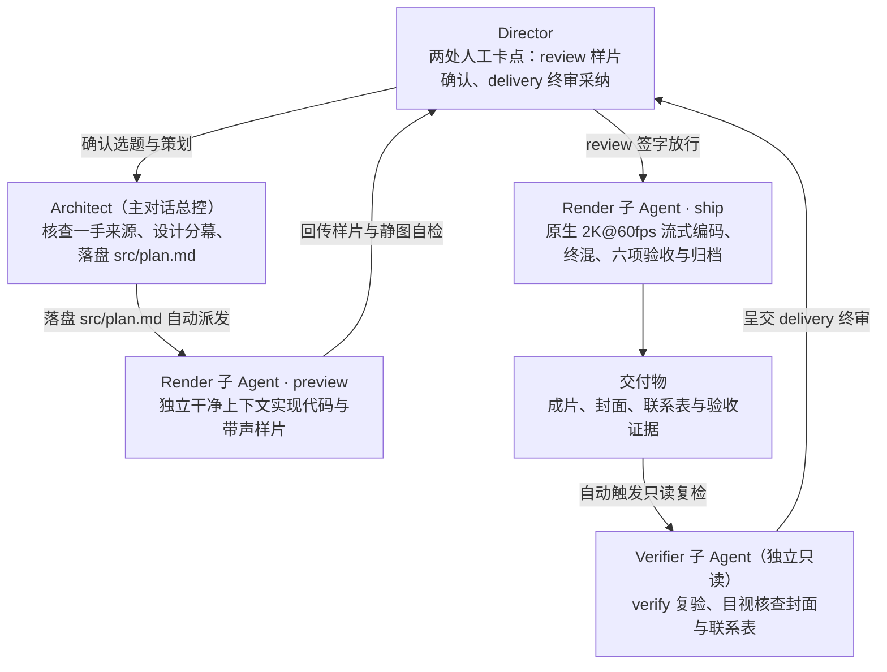

# MakeYourVideo

以 Remotion、Python 和 FFmpeg 制作原生 1440×2560、60 fps 的无旁白科普短片。每期以 `beats.json` 驱动画面，以程序微音效和配乐配合叙事。

## 🎬 成片演示 / Showcase

[在 B 站观看《为什么食盐是咸的》](https://www.bilibili.com/video/BV1VVy7zYEHZ/)

## 制作架构



不再需要常驻独立的运维 Agent；公共工具（`tools/`）、制作档案（`tools/profiles/`）与共享底座（`core/vibe/`）按需在单独维护会话迭代。各角色的自动编排、交接与返工方式见[协作流程](docs/PROCESS.md)。

## How to Use

可以先在 Remotion Studio 播放圆周角几何示例。要制作完整短片，则准备单期源码和素材，依次生成带声样片、确认 `review`、执行 `ship`、复验并确认 `delivery`。

### 各份文档与 Agent 技能怎么用

| 文档 / 技能 | 什么时候读、交给谁 |
| --- | --- |
| [`AGENTS.md`](AGENTS.md) | 仓库根规则入口。支持 `AGENTS.md` 自动发现的客户端（如 Antigravity、Codex）打开仓库即自动加载，总览红线与单窗口多 Agent 架构。 |
| [`.agents/skills/`](.agents/skills/produce-episode/SKILL.md) | 内置三份标准 Agent Skills（[`produce-episode`](.agents/skills/produce-episode/SKILL.md)、[`render-episode`](.agents/skills/render-episode/SKILL.md)、[`verify-episode`](.agents/skills/verify-episode/SKILL.md)），支持子 Agent 编排的客户端克隆后开箱即用。 |
| [`docs/AGENTS.md`](docs/AGENTS.md) | 单期制作约定（交付归档的规则快照）。规定单期边界、事实和素材授权要求以及两处人工确认。 |
| [`docs/prompt.md`](docs/prompt.md) | 策划模板。在本地工作区可直接落盘 `src/plan.md` 等策划文件；在无磁盘权限的网页 LLM 中也可输出完整方案正文。 |
| [`docs/PROCESS.md`](docs/PROCESS.md) | 协作与返工手册。说明单窗口自动流、跨会话 `src/plan.md` 磁盘交接、以及 `handoff` / `resolve` 返工记录方式。 |
| [`docs/STYLE_B_SILENT_VIBE.md`](docs/STYLE_B_SILENT_VIBE.md) | 策划设计分幕、渲染编写画面、人工审片时读。定义画面、音效、阅读窗和视觉取证要求。 |
| [`docs/PRODUCTION.md`](docs/PRODUCTION.md) | 实际操作时打开。查单期目录、清单、快审、全片、验收和交付命令。 |
| [字体清单](assets/fonts/FONT-NOTICE.md)、[配乐说明](assets/bgm/README.md) | 准备素材时读。分别核对字体文件名、配乐授权、节拍分析和清单字段。 |
| [示例事实文件](examples/diameter/facts_and_sources.md) | 写自己的 `facts_and_sources.md` 时参考。逐项记录上屏论断、推导、一手出处和素材授权。 |

### 如何分配给 Agent

仓库同时支持**单窗口自动流**与**跨会话磁盘交接**两种工作方式，均保证「策划脑暴」与「高精编码渲染」上下文物理隔离：

#### 方式一：单窗口自动流（推荐，支持子 Agent 编排的客户端，如 Antigravity）

克隆仓库后直接打开项目根，`.agents/skills/` 会被自动发现，**一集片子只开一个主对话**（下一集新开会话）：

1. **主对话（总控 + Architect）**：直接说「开新片：<选题>」，主对话按 [`produce-episode`](.agents/skills/produce-episode/SKILL.md) 陪你核查一手来源、设计分幕，并将 `facts_and_sources.md`、`beats.json`、`src/manifest.json` 与单期方案 **`src/plan.md`** 落盘到本期目录。
2. **自动派发 Render 子 Agent**：你在同一窗口回复确认开渲后，主对话自动拉起全新隔离上下文的满血 `self` 子 Agent（按 [`render-episode`](.agents/skills/render-episode/SKILL.md) 执行），完成底座快照、Remotion 视觉/音效/取证代码编写、`preview` 与静图自检，自动回传样片供你审看——全程免手动开第二窗口、免复制粘贴提示词。
3. **同窗口 `review` 返工与 `ship`**：提修改意见时，主对话登记 `handoff` 并直接发回**同一个待命中的 Render 子 Agent** 定点修复；确认样片后，主对话登记 `review` 并自动通知其运行 `ship`。
4. **自动拉起只读 Verifier 子 Agent**：`ship` 完成后主对话自动拉起独立只读子 Agent（按 [`verify-episode`](.agents/skills/verify-episode/SKILL.md) 执行 `verify` 与目视复核），全绿后呈交你在同一窗口确认 `delivery`。

#### 方式二：多会话磁盘交接（兼容任意 LLM / CLI / 网页对话）

若使用的工具不支持子 Agent 自动派发，可按职责拆为两个独立会话，通过磁盘上的 **`src/plan.md`** 交接（同样无需粘贴长提示词）：

1. **策划会话（Architect）**：用 [`docs/prompt.md`](docs/prompt.md) 与选题材料启动会话，将 `facts_and_sources.md`、`beats.json`、初始 `src/manifest.json` 和 **`src/plan.md`** 写入本期目录（网页端无磁盘权限时保存输出的方案正文为 `src/plan.md`）。
2. **渲染会话（Render）**：新开擅长编程的独立会话，仅告知本期目录 `$ep`，让它读取 `src/plan.md` 与 `docs/PRODUCTION.md` 实现并制作 `preview`；`review` 确认后继续执行 `ship`，交付前可另开只读会话运行 `tools/episode.py verify $ep` 复核。

> 公共工具（`tools/`）、制作档案（`tools/profiles/`）与共享底座（`core/vibe/`）的迭代或回归测试，按需另开独立维护会话处理，避免与单期渲染混用上下文。

### 1. 安装依赖并打开示例

安装 [Node.js](https://nodejs.org/)（`^20.19.0 || ^22.13.0 || >=24`），然后运行以下命令。已经克隆仓库时，从仓库根目录执行 `npm ci` 和 `npm run dev` 即可。

```powershell
git clone https://github.com/Heersley/MakeYourVideo.git
cd MakeYourVideo
npm ci
npm run dev
```

打开终端输出的 Studio 地址，在左侧选择 **Diameter**，播放[圆周角源码示例](examples/diameter/)的几何预览。制作带声样片时，在另一个 PowerShell 窗口进入同一个仓库根目录。

### 2. 准备正式渲染环境

- 使用支持 D3D11VA 的 Windows，并安装 Chrome 或 Edge。
- 安装 [Python 3.12.4](https://www.python.org/downloads/release/python-3124/)。
- 将 [FFmpeg 和 ffprobe 9.0.2](https://www.gyan.dev/ffmpeg/builds/#release-builds) 的两个可执行文件放在同一 `bin` 目录，并将该目录加入 PATH。
- 按[字体清单](assets/fonts/FONT-NOTICE.md)将 8 个字体文件放进 `assets/fonts/`。示例初始化会把字体复制到本期素材目录。

在仓库根目录创建 Python 环境。下面其余步骤沿用同一 PowerShell 窗口中的 `$python` 和 `$ep`。

```powershell
python -m venv .venv
$python = '.\.venv\Scripts\python.exe'
& $python -m pip install -r requirements.txt
```

### 3. 生成一条带声样片

使用一个尚未存在的单期目录。圆周角示例会创建分幕、事实文件和渲染入口，生成配乐、节拍档案和立体声微音效，并固定本期的共享底座。

```powershell
$ep = "output/evergreen_vibe/$(Get-Date -Format yyyy-MM-dd)/01_diameter"
& $python -B examples/diameter/prepare.py $ep
```

初始化成功后，预检并制作样片。

```powershell
& $python -B tools/episode.py preflight $ep --mode preview
if ($LASTEXITCODE -eq 0) {
    & $python -B tools/episode.py preview $ep
}
```

示例会生成 30 秒、720×1280、30 fps 的带声样片。打开本期 `src/review/preview.mp4`，在同目录查看道具特写、文字尾迹、高潮静帧、手机缩略图和 `preview_qc.json`。

### 4. 换成自己的题材

在 `output/evergreen_vibe/YYYY-MM-DD/NN_主题/` 为每条视频创建独立目录。下面以示例初始化脚本生成可编辑的起点。把 `02_my_topic` 换成本期编号和主题，再按下表替换内容。

```powershell
$ep = "output/evergreen_vibe/$(Get-Date -Format yyyy-MM-dd)/02_my_topic"
& $python -B examples/diameter/prepare.py $ep
```

| 文件或目录 | 要准备的内容 |
| --- | --- |
| `beats.json` | 按[分幕格式](tools/contracts/beats.schema.json) 编排每幕的起止、阅读窗、上屏文字、音效时间与配乐高潮点。用正式帧率的整数帧对齐边界。 |
| `facts_and_sources.md` | 记录上屏论断、推导、一手出处和素材授权。 |
| `src/plan.md` | 可选，由 Architect 落盘的单期视觉世界观、逐幕演法、常量与音色方案，供 Render 直接读盘开工（位于 `src/` 内，不占用交付根目录七件白名单，也不影响内容指纹）。 |
| `src/entry.tsx` | 实现图形、文字和动效，注册样片与正式片两个 Remotion Composition。两者共用原生画幅，帧率和长度分别对齐档案与分幕。 |
| `src/manifest.json` | 按[清单格式](tools/contracts/manifest.schema.json)填写入口、两个 Composition ID、样片帧数、制作档案、素材目录、音效和取证入口。示例绑定 [vibe-3.3](tools/profiles/vibe-3.3.json)。 |
| `src/assets/`、`src/sfx.wav` | 将静态素材和字体放入清单的 `publicDir`，默认是 `src/assets/`。修改分幕的音效节奏后，重新生成与时间轴匹配的微音效 WAV。程序合成可参考[示例初始化脚本](examples/diameter/prepare.py)中的 `render_sfx` 调用。 |
| `src/evidence/frames.py` | 更新封面、道具、文字尾迹和高潮的代表帧，让 `evidence_kit` 生成审片与全片取证文件。这里填写正式时间轴的帧号。 |

使用自备且获授权的配乐时，先分析节拍，再把对应的 `bgm` 路径和 `licenseNote` 填入本期清单。例如将 `bgm` 设为 `assets/bgm/track.wav`，并在 `licenseNote` 写明授权依据。配乐路径相对仓库根目录。

```powershell
& $python -B tools/bgm_analyze.py assets/bgm/track.wav
```

手工创建单期时，把 `$ep` 设为本期目录，再固定 `core/vibe` 快照，渲染入口应从本期 `src/vendor/vibe/` 导入。示例初始化已执行了快照步骤。

```powershell
& $python -B tools/episode.py snapshot $ep
```

文件准备好后，按第 3 步的命令预检并生成本期样片。

### 5. 确认样片并制作全片

样片通过取证且实际审看确认后，才登记 `review`。把命令里的占位文字换成真实确认意见。

```powershell
& $python -B tools/episode.py approve $ep --gate review --note '<实际样片确认意见>'
if ($LASTEXITCODE -eq 0) {
    & $python -B tools/episode.py ship $ep
}
```

`ship` 会流式编码正式片、校准终混响度、生成封面与联系表、执行 D3D11VA 对拍等验收，并归档证据。成功后，本期根目录会有正式 MP4、`cover.png`、`contact_sheet.png`、混音报告及事实文件，取证记录保存在 `src/`。分幕、源码、素材或配乐有改动时，重新生成样片并确认 `review`。

### 6. 复验与确认交付

在审看正式成片前，可以用 `verify` 只读复验归档结果，并用 `status` 查看当前卡点。

```powershell
& $python -B tools/episode.py verify $ep
& $python -B tools/episode.py status $ep
```

实际采纳成片后，登记 `delivery`。完成时，`status` 的 `nextGate` 为 `done`。

```powershell
& $python -B tools/episode.py approve $ep --gate delivery --note '<实际终审采纳意见>'
& $python -B tools/episode.py status $ep
```

路径规则、返工记录和命令参数见[制作手册](docs/PRODUCTION.md)。

## 许可

本项目源码与文档依 [MIT](LICENSE) 许可。Remotion 使用[独立许可](https://www.remotion.dev/license)，字体使用各发布方的 SIL OFL 1.1 许可。
