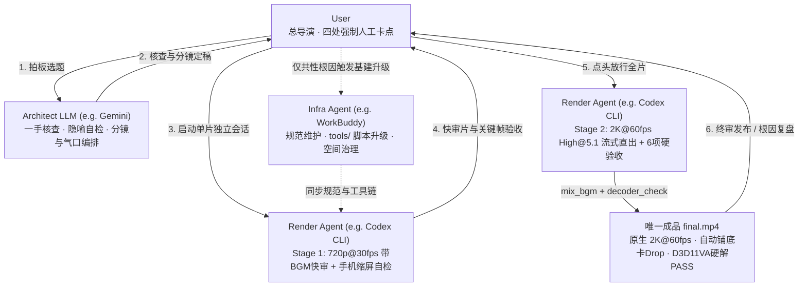

# MakeYourVideo

> **0 人声 · 原生 2K@60fps 的 Vibe 知识大赏类短视频生产框架**（Remotion + Python + FFmpeg）

**MakeYourVideo** 是一套面向 0 人声、电影感 9:16 竖屏知识短片的生产框架。单份 beats.json 时间轴驱动全片：Remotion 掌管动效与排版，Python 负责卡拍配乐与硬解验收。无人声、无字幕带——唯有字体、几何、光影与声景。

```bash
git clone https://github.com/Heersley/MakeYourVideo.git
cd MakeYourVideo
```

## 🎬 成片演示 / Showcase

> **完整成片观看（Bilibili）**：👉 **[点击观看成品演示](https://t.bilibili.com/1273093177771819012)**
>

<table>
  <tr>
    <td align="center" width="25%">
      <br/>
      <sub><b></sub>
    </td>
    <td align="center" width="25%">
      <br/>
      <sub><b></sub>
    </td>
    <td align="center" width="25%">
      <br/>
      <sub><b></sub>
    </td>
    <td align="center" width="25%">
      <br/>
      <sub><b></sub>
    </td>
  </tr>
</table>

---

## 🏗️ 多 AI 角色协作与 6 项硬验收架构




---

## 它解决什么问题

- **0 人声**：不配音、不做逐词字幕，靠 `beats.json` 连续时间轴 + 大字 + 图形演化 + 微音效 + 配乐。
- **原生 2K**：`1440×2560 @ 60fps`、H.264 `High@5.1`（`Level 4.2/5.0` 的宏块上限装不下 864,000 宏块/秒）。
- **程序验收**：6 项硬指标，保证生成的视频不炸钢。
- **可复现**：仓库只有源码、依赖清单与规范，搭配智能体即可轻松复现。

> `examples/nim_game/` 是一条 184 秒 / 31 幕的完整参考实现，**1080p 时代产物**：学状态机写法与验收脚本，不要把它的 `-level:v 4.2` 照抄到 2K 新片。

---

## 四方协作架构

| 角色 | 定位 | 核心职责 |
|---|---|---|
| **决策者（人）** | 导演 / 最终决策 | 选题、事实口径、快审、交付四处拍板 |
| **编导** | 事实核查 / 提示词架构 | 一手核查、隐喻自检、分幕与气口、写执行指令 |
| **成片工程** | 生产侧 | 源码、两阶段渲染、6 项验收、混音、清理临时目录 |
| **基建维护** | 规范 / 工具 / 运维 | 文档与 `tools/` 维护、目录与磁盘 |

角色是职责而不是产品名，可由任意等效工具承担；关键是四种职责不合并到同一个会话。完整流水线、角色 × 阶段矩阵、交接物与返工路径见 [`docs/PROCESS.md`](docs/PROCESS.md)。

---

## 目录

```text
MakeYourVideo/
├── README.md · LICENSE · .gitignore · .gitattributes
├── package.json                 Remotion 4.0.545 / React 19
├── requirements.txt             numpy / opencv / pillow / scipy / fonttools / brotli / playwright
├── docs/
│   ├── PROCESS.md               协作流程与四个卡点
│   ├── AGENTS.md                生产执行规范（目录、交付白名单、硬规则）
│   ├── STYLE_B_SILENT_VIBE.md   视觉与验收规范（2K、节奏、排版、编码、6 项验收）
│   └── PROMPT_TEMPLATE.md       分阶段执行指令模板
├── tools/
│   ├── bgm_common.py            FFmpeg 定位 / PCM 解码 / 时长探测
│   ├── bgm_analyze.py           测拍 → beats.json（BPM / 小节 / Drop）
│   ├── mix_bgm.py               卡 Drop + 前段铺底 + 断层自检 + 唯一成片
│   ├── decoder_check.py         硬解 vs 软解 NV12 对拍 + 编码档位审计
│   └── style_brief.py           从成片反推底色 / 色板 / 字阶
├── assets/
│   ├── bgm/README.md            自备 CC0 / 已授权配乐
│   └── fonts/README.md          三套 SIL OFL 1.1 字体的下载与放置
└── examples/nim_game/           可复现示例（纯源码，无产物）
```

---

## 环境依赖

| 依赖 | 要求 | 校验 |
|---|---|---|
| Node.js | `^20.19` / `^22.13` / `>=24` | `node -v` |
| Python | 3.11+（开发用 3.12；3.13 亦可） | `python -V` |
| FFmpeg / ffprobe | **7+**（推荐 9.0.2），含 `libx264`；硬解验收需 `d3d11va`（Windows） | `ffmpeg -version` |
| 磁盘 | 2K 成片 18–65 MB / 条，渲染中间物另需 1–2 GB | — |

> **FFmpeg 版本口径**：`tools/bgm_common.py` 与 `tools/decoder_check.py` 的硬门槛都是 **major ≥ 7**（低于 7 缺 `d3d11` 输出格式与新 `-fps_mode` 语法）；9.0.2 是开发验证版本，只用于报告里的 `pinnedMatched` 提示，不强制。
>
> **PATH 上有旧 FFmpeg 时**：两个工具都会自动跳过 major < 7 的构建。若你的 `ffmpeg -version` 明显偏旧（如 2013 年的 `N-55702`），用环境变量指定新版即可，无需改 PATH：
>
> ```bash
> export FFMPEG_BIN=/path/to/ffmpeg-9.0.2/bin/ffmpeg.exe   # Windows: set FFMPEG_BIN=...
> ```
>
> 定位优先级：显式 `--ffmpeg` 参数 → `FFMPEG_BIN` → Windows WinGet 包目录 → `PATH`。

> 硬解对拍只在 Windows D3D11VA 下有效；macOS / Linux 会退化为软解一致性与编码档位审计，属预期行为。

---

## 从零复现

```bash
# 1) Node 依赖
npm install

# 2) Python 依赖
python -m venv .venv
. .venv/Scripts/activate            # Windows；macOS/Linux: source .venv/bin/activate
pip install -r requirements.txt
playwright install chromium         # 只有跑示例的版面/快审 QC 才需要

# 3) 开源字体 → public/fonts/（下载地址与文件清单见 assets/fonts/README.md）
mkdir -p assets/fonts public/fonts  # public/ 不在仓库里，必须先建
#   把 6 个字重文件直接放进 public/fonts/（Remotion staticFile 根）；
#   assets/fonts/ 是可选的长期归档位，QC 与渲染都会自动回退查找。

# 4) 自备配乐 → assets/bgm/
cp <your-cc0-track>.m4a assets/bgm/
python tools/bgm_analyze.py assets/bgm/<your-cc0-track>.m4a

# 5) 生成示例的程序化道具、微音效，并渲染
cd examples/nim_game
python src/gen_stones.py            # → src/assets/stone_v0..3.png
python src/gen_sfx.py               # → src/sfx_mix.wav（约 35 MB，混音要用）
cd ../..
cp examples/nim_game/src/assets/stone_v*.png public/
npm run render:example              # 184s 全片；先试 10 秒加 --frames=0-599（60fps）

# 6) 混音成唯一成片 + 硬解验收
python tools/mix_bgm.py \
  --video out/nim-cinema.mp4 \
  --bgm assets/bgm/<your-cc0-track>.m4a \
  --sfx examples/nim_game/src/sfx_mix.wav \
  --output out/nim.mp4 \
  --align-climax 122 \
  --sfx-out out/sfx_only.wav

python tools/decoder_check.py --video out/nim.mp4 --output out/decoder_check.json --strict
```

> **`--frames` 是闭区间**：`--frames=0-599` = 600 帧 = 10.0 s @60fps；想要正好 5 s 请写 `--frames=0-299`（不是 `0-300`）。
>
> **色彩范围必须显式指定**：Remotion 默认输出 full-range `yuvj420p`，会让 `decoder_check.py` 的 `yuv420p` 基线判失败。`npm run render:example` 已内置 `--color-space=bt709`；自己手写 `remotion render` 命令时务必一并带上 `--pixel-format=yuv420p --color-space=bt709`。
>
> **微音效走 `--sfx`**：`examples/nim_game` 的 Remotion 合成里没有挂 `<Audio>`，渲染中间片是无音轨的。想让成片带 25 个微音效，必须显式传 `--sfx examples/nim_game/src/sfx_mix.wav`；不传则 `--sfx-out` 导出的是近似静音母带（工具会打 warning 提示）。
>
> **`-level:v` 到底怎么定**：Remotion 4.0.545 的 CLI **没有** `--level` / `--x264-params` 入口。日常直接用 `npm run render:example` 即可——1080p@60 下 x264 会自然产出 `High@5.0`，`decoder_check.py` 已把 1080p@60 放行到 `{4.2, 5.0}` 两档。
>
> 若确实需要**强制指定精确的 Level / GOP**（例如 2K 必须 `High@5.1` + `-g 120`），不能靠 `-c:v copy` 改封装——**`-c:v copy` 只搬运码流、不会改写 H.264 编码级别**，必须真正重编码一次，走 FFmpeg 完整参数：
>
> ```bash
> ffmpeg -i in.mp4 -c:v libx264 -profile:v high -level:v 5.1 \
>   -pix_fmt yuv420p -crf 16 -preset slow -g 120 -movflags +faststart out.mp4
> ```
>
> 核心是**不要用 `slice-max-mbs`、多 slice、全 I 帧**——这三样会让 D3D11VA 解出纯灰块。

---

## 排错

| 现象 | 原因 | 处理 |
|---|---|---|
| `Chrome ran out of memory or disk space` / `Timed out ... delayRender()` | 渲染并发过高（2K 渲染、或本机浏览器标签较多时尤其明显），Chrome 实例吃满内存 | 在 Remotion 命令后加 `--concurrency=2` 或 `--concurrency=3` 降低并发，例如 `npm run render:example -- --concurrency=3` |
| 渲染报 6 个 `404 (Not Found)` + `NetworkError` | `public/fonts/` 里缺字体，或文件名与 `Fonts.tsx` 的 `faces` 表不一致 | 按 `assets/fonts/README.md` 的 6 个文件名逐字符核对 |
| `decoder_check.py` 报「像素格式并非 yuv420p（yuvj420p）」 | 渲染时漏了 `--color-space=bt709` | 补上该参数重渲（`render:example` 已内置） |
| `[fill] 未找到可用铺底乐段` / `[fill][warn] 铺底降档` | 配乐偏短、`--align-climax` 远大于曲长 | 已有降档与 warning；若仍无解请换更长的曲子或调小 `--align-climax` |
| `未找到 FFmpeg` / 版本被拒 | PATH 上的 `ffmpeg` 低于 major 7 | 用 `FFMPEG_BIN` 指定新版可执行文件 |
| `No native Remotion PNGs were found` | `full_qc.py` 需要原生 PNG 序列，仓库不提供 | 见 `examples/nim_game/README.md` 的「版面 / 快审 QC 怎么跑」 |

---

## 规范地图

| 想知道 | 去读 |
|---|---|
| 一条片怎么从选题走到交付、卡在哪 | `docs/PROCESS.md` |
| 目录、交付白名单、六条硬性规则 | `docs/AGENTS.md` |
| 2K 画幅、节奏、排版、线宽、编码、6 项验收 | `docs/STYLE_B_SILENT_VIBE.md` |
| 怎么给编码代理下指令 | `docs/PROMPT_TEMPLATE.md` |
| 工具参数 | `python tools/<script>.py --help` |

---

## 许可

- **本仓库代码与文档**：MIT，Copyright (c) 2026 **Heersley**。
- **Remotion**：自有许可，个人 / 小团队免费，**公司 ≥4 人需购买 Company License**；商用前阅读 <https://www.remotion.dev/license>。
- **字体**：Source Serif 4、寒蝉锦书宋 V2.0、Noto Sans SC、JetBrains Mono 均为 **SIL OFL 1.1**，可免费商用；字体文件不随仓库分发。
- **配乐**：仓库不含任何音频。请使用 **CC0 / 已获商用授权**的曲目；`tools/mix_bgm.py` 只做对齐与混音，不授予任何音乐版权。
- **示例内容**：`examples/nim_game/facts_and_sources.md` 中的事实与出处仅用于演示「一手 URL 闭环」的写法。

---

## 边界

这是**生产规范 + 工具链**仓库，不是成品视频仓库：不含成片、字体、配乐、QC 日志与任何个人环境配置。
