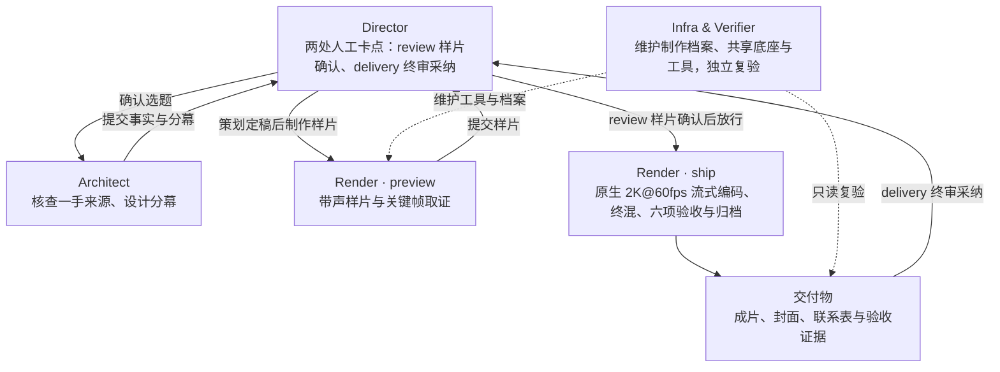

# MakeYourVideo

以 Remotion、Python 和 FFmpeg 制作原生 1440×2560、60 fps 的无旁白科普短片。每期以 `beats.json` 驱动画面，以程序微音效和配乐配合叙事。

## 🎬 成片演示 / Showcase

> [观看尼姆博弈成片（Bilibili）](https://t.bilibili.com/1273093177771819012)

<table>
  <tr>
    <td align="center" width="25%">
      
    </td>
    <td align="center" width="25%">
      
    </td>
    <td align="center" width="25%">
      
    </td>
    <td align="center" width="25%">
      
    </td>
  </tr>
</table>

## 制作架构



角色分工与返工见[协作流程](docs/PROCESS.md)。新会话可使用[单期提示词](docs/prompt.md)。

## 运行示例

安装 [Node.js](https://nodejs.org/)（`^20.19.0 || ^22.13.0 || >=24`），然后在终端运行：

```text
git clone https://github.com/Heersley/MakeYourVideo.git
cd MakeYourVideo
npm ci
npm run dev
```

在 Remotion Studio 选择 **Diameter**，播放[圆周角源码示例](examples/diameter/)的几何预览。这一步只需 Node.js，示例图形由代码生成。

## 制作一条带声样片

正式流程使用支持 D3D11VA 的 Windows、[Python 3.12.4](https://www.python.org/downloads/release/python-3124/)、同目录的 [FFmpeg 和 ffprobe 9.0.2](https://www.gyan.dev/ffmpeg/builds/#release-builds)，以及 Chrome 或 Edge。将 FFmpeg 的 `bin` 目录加入 PATH，按[字体清单](assets/fonts/FONT-NOTICE.md)将 8 个文件放入 `assets/fonts/`。示例会生成配乐和微音效。

在 PowerShell 的仓库根目录运行：

```powershell
python -m venv .venv
$python = '.\.venv\Scripts\python.exe'
& $python -m pip install -r requirements.txt
$ep = "output/evergreen_vibe/$(Get-Date -Format yyyy-MM-dd)/01_diameter"
& $python -B examples/diameter/prepare.py $ep
if ($LASTEXITCODE -eq 0) {
    & $python -B tools/episode.py preview $ep
}
```

样片及取证文件位于本期 `src/review/`。审完样片后登记 `review`，再用 `ship` 制作、验收与归档全片。审完交付物后登记 `delivery`。命令和单期文件结构见[制作手册](docs/PRODUCTION.md)。

## 许可

本项目源码与文档依 [MIT](LICENSE) 许可。Remotion 使用[独立许可](https://www.remotion.dev/license)，字体使用各发布方的 SIL OFL 1.1 许可。
